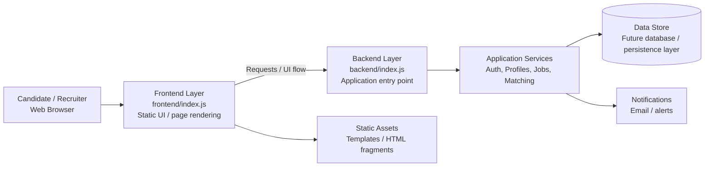

# NaukriForSkilled Architecture Overview

This document provides a simplified architectural view of the application as it currently exists in the repository.

## Notes

- The repository currently contains a lightweight frontend and backend structure, with both areas beginning in an early stage.
- The architecture is intentionally shown as a modular design so it can evolve as business features are added.
- As the project grows, authentication, APIs, job management, and candidate/recruiter workflows can be introduced into the service layer.
